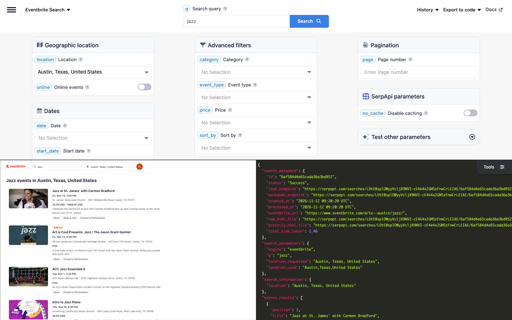

# Eventbrite Scraper

Scrape Eventbrite events with SerpApi's Eventbrite Search API. Search the events of a city, region, or country, or Eventbrite's online events, by date, category, type, and price, and get each event's title, link, ID, description, start and end times, venue with its address and coordinates, ticket prices, image, category, and type, and whether it's online or sold out.

## How to scrape Eventbrite search results

Search Eventbrite with a simple GET request:

```text
https://serpapi.com/search?engine=eventbrite&q=jazz&location=Austin%2C+Texas%2C+United+States&api_key=SERPAPI_API_KEY
```

- `location` is the place to search events in, e.g., `Austin, Texas, United States` or `Berlin, Germany`. It's required unless you set `online`. A city works best, but a region, a borough, e.g., `Brooklyn, New York, United States`, or a country also works, and `search_information.location` shows the place searched.
- `online` set to `true` searches Eventbrite's online events instead of the events of a place. It can't be used with `location`.
- `api_key` is your SerpApi API key. Replace `SERPAPI_API_KEY` with it.
- `q` is the search query, e.g., `jazz`, `comedy`, or `tech meetup`. It's optional and works like Eventbrite's search box: some queries, e.g., `comedy`, return only the matching events, while others, e.g., `jazz`, return all the events of the place with the best matches first.
- `date` searches the events of `today`, `tomorrow`, `this_weekend`, `this_week`, `next_week`, `this_month`, or `next_month`. For other dates, set `start_date` and `end_date`, e.g., `2026-12-12` and `2026-12-14`.
- `category`, `event_type`, and `price` only show the events of a category, a type, or a price, e.g., `music`, `concert`, and `free`.
- `sort_by` set to `date` sorts the events by date instead of relevance.
- `page` gets the next pages of results. Each page has up to 20 events, and a search has up to 50 pages.

A search needs either `location` or `online` set to `true`. Without either, the API returns `400` and "Either `location` should be specified, or `online` should be set to `true`.", and with both, "`location` and `online` parameters can't be used together." A past `start_date` returns "`start_date` cannot be in the past.", and a `page` over 50 returns "`page` parameter must be an integer between 1 and 50."

Because some queries only rank the events, `q` never empties a search: even a query that matches nothing, e.g., `qwxzzyplkvv`, returns all the events of the place. To get only matching events, use `category`, `event_type`, `price`, or the dates.

Some locations become a different place: `England, United Kingdom` searches Warwickshire, and `San Francisco Bay Area, California, United States` searches all of California. `Miami` matches Miami-Dade County, which has no Eventbrite place, so the response has no events and the error "Eventbrite hasn't returned any place for `Miami` location. Use a city-level location instead." Use `Miami, Florida, United States` instead.

[Register at SerpApi](https://serpapi.com?utm_source=github_eventbrite_scraper) to get your API key, and keep it private.

### Playground

Try the request live in the [SerpApi Playground](https://serpapi.com/playground?engine=eventbrite&q=jazz&location=Austin%2C+Texas%2C+United+States&utm_source=github_eventbrite_scraper).

[](https://serpapi.com/playground?engine=eventbrite&q=jazz&location=Austin%2C+Texas%2C+United+States&utm_source=github_eventbrite_scraper)

## Code examples

The code examples read your API key from the `SERPAPI_API_KEY` environment variable:

```bash
export SERPAPI_API_KEY="SERPAPI_API_KEY"
```

Each example searches Eventbrite for jazz events in Austin, Texas, and prints the title, start date, and price of each event.

### curl integration

Send the request with curl, which prints the full JSON response:

```bash
curl --get https://serpapi.com/search \
 --data-urlencode engine="eventbrite" \
 --data-urlencode q="jazz" \
 --data-urlencode location="Austin, Texas, United States" \
 --data-urlencode api_key="$SERPAPI_API_KEY"
```

### JavaScript integration

Install the [SerpApi JavaScript library](https://github.com/serpapi/serpapi-javascript) and set your project to use ES modules:

```bash
npm install serpapi
npm pkg set type=module
```

Create an `index.js` file:

```javascript
import { getJson } from "serpapi";

const results = await getJson({
  engine: "eventbrite",
  api_key: process.env.SERPAPI_API_KEY,
  q: "jazz",
  location: "Austin, Texas, United States",
});

for (const event of results.events_results ?? []) {
  console.log(event.title, event.start_date, event.price);
}
```

Run it with `node index.js`.

### Python integration

Install the [SerpApi Python library](https://github.com/serpapi/serpapi-python):

```bash
pip install serpapi
```

Create a `main.py` file:

```python
import os
import serpapi

client = serpapi.Client(api_key=os.getenv("SERPAPI_API_KEY"))
results = client.search({
    "engine": "eventbrite",
    "q": "jazz",
    "location": "Austin, Texas, United States",
})

for event in results.get("events_results", []):
    print(event["title"], event["start_date"], event.get("price"))
```

Run it with `python main.py`.

### Ruby integration

Install the [SerpApi Ruby library](https://github.com/serpapi/serpapi-ruby):

```bash
gem install serpapi
```

Create a `main.rb` file:

```ruby
require "serpapi"

client = SerpApi::Client.new(engine: "eventbrite", api_key: ENV.fetch("SERPAPI_API_KEY"))
results = client.search(q: "jazz", location: "Austin, Texas, United States")

results.fetch(:events_results, []).each do |event|
  puts "#{event[:title]} #{event[:start_date]} #{event[:price]}"
end

client.close
```

Run it with `ruby main.rb`.

### PHP integration

Install the [SerpApi PHP library](https://github.com/serpapi/serpapi-php):

```bash
composer require serpapi/serpapi-php
```

Create an `index.php` file:

```php
<?php
require 'vendor/autoload.php';

use SerpApi\Client;

$client = new Client(getenv('SERPAPI_API_KEY'), 'eventbrite');
$results = $client->search([
  'q' => 'jazz',
  'location' => 'Austin, Texas, United States',
]);

foreach ($results->events_results ?? [] as $event) {
  echo $event->title . ' ' . $event->start_date . ' ' . ($event->price ?? '') . PHP_EOL;
}
```

Run it with `php index.php`.

### Go integration

Create a Go module and install the [SerpApi Go library](https://github.com/serpapi/serpapi-golang):

```bash
go mod init example.com/eventbrite
go get github.com/serpapi/serpapi-golang
```

Create a `main.go` file:

```go
package main

import (
	"fmt"
	"os"

	"github.com/serpapi/serpapi-golang"
)

func main() {
	setting := serpapi.NewSerpApiClientSetting(os.Getenv("SERPAPI_API_KEY"))
	setting.Engine = "eventbrite"
	client := serpapi.NewClient(setting)

	results, err := client.Search(map[string]string{
		"q":        "jazz",
		"location": "Austin, Texas, United States",
	})
	if err != nil {
		panic(err)
	}

	eventsResults, _ := results["events_results"].([]interface{})
	for _, item := range eventsResults {
		event := item.(map[string]interface{})
		fmt.Println(event["title"], event["start_date"], event["price"])
	}
}
```

Run it with `go run .`.

### Rust integration

Create a Cargo project and add the [SerpApi Rust library](https://github.com/serpapi/serpapi-rust) and Tokio:

```bash
cargo new eventbrite && cd eventbrite
cargo add serpapi tokio --features tokio/full
```

Replace `src/main.rs` with:

```rust
use serpapi::serpapi::Client;
use std::collections::HashMap;
use std::env;

#[tokio::main]
async fn main() -> Result<(), Box<dyn std::error::Error>> {
    let mut default = HashMap::new();
    default.insert("api_key".to_string(), env::var("SERPAPI_API_KEY")?);
    default.insert("engine".to_string(), "eventbrite".to_string());
    let client = Client::new(default)?;

    let mut parameter = HashMap::new();
    parameter.insert("q".to_string(), "jazz".to_string());
    parameter.insert("location".to_string(), "Austin, Texas, United States".to_string());

    let results = client.search(parameter).await?;
    if let Some(events_results) = results["events_results"].as_array() {
        for event in events_results {
            println!(
                "{} {} {}",
                event["title"].as_str().unwrap_or_default(),
                event["start_date"].as_str().unwrap_or_default(),
                event["price"].as_str().unwrap_or_default()
            );
        }
    }
    Ok(())
}
```

Run it with `cargo run`.

### Other programming languages

Official libraries are also available for [Java](https://github.com/serpapi/serpapi-java), [.NET](https://github.com/serpapi/serpapi-dotnet), [Swift](https://github.com/serpapi/serpapi-swift), and [C++](https://github.com/serpapi/serpapi-cpp). See [SerpApi integrations](https://serpapi.com/integrations?utm_source=github_eventbrite_scraper) for setup guides, or use a simple GET request from any programming language.

### Errors

Failed requests return an HTTP error status and a JSON body with an `error` message. The most common are `401` for an invalid API key, `400` for a search without `location` or `online` set to `true`, and `429` when you exceed your hourly throughput limit or run out of searches. See [API status and error codes](https://serpapi.com/api-status-and-error-codes?utm_source=github_eventbrite_scraper) for the full list.

A search without events, e.g., with filters no event matches or a page after the last one, still returns `200`, with `search_metadata.status` set to `Success`, `search_information.events_results_state` set to `Fully empty`, and the error "Eventbrite hasn't returned any results for this query.", so check for `error` before reading `events_results`.

## Output formats: JSON and Markdown

Choose structured JSON for applications or Markdown for LLMs and AI agents:

- JSON is the default output and is useful when you need individual result fields.
- Add `output=md` to receive Markdown instead, which is more token-efficient.

Markdown is plain text, not JSON: YAML front matter with the search metadata, followed by the place searched, a table of the events, and links to the other pages. The venue names and coordinates are only in the JSON response. Read the response body as text instead of parsing it.

| Client | Markdown request |
|--------|------------------|
| curl | `--data-urlencode output="md"` |
| Python | `client.search({..., "output": "md"})` |
| PHP | `$client->md([...])` |
| Go | `client.Md(map[string]string{...})` |
| Rust | `client.md(parameter).await?` |

If your SDK doesn't have a Markdown helper yet, send a plain HTTP request with `output=md` and read the body as text. Learn more about [Markdown output](https://serpapi.com/markdown-output?utm_source=github_eventbrite_scraper).

## Eventbrite Search API parameters

See the [Eventbrite Search API documentation](https://serpapi.com/eventbrite-search-api?utm_source=github_eventbrite_scraper) for more details.

| Name | Description | Requirement |
|------|-------------|-------------|
| **Search query** | | |
| `q` | The search query (e.g., `jazz`, `yoga`, or `tech meetup`). It works like Eventbrite's search box: some queries (e.g., `comedy`) return only the matching events, while others (e.g., `jazz`) return all the events of the place with the best matches first, so even a query that matches nothing returns events. Without `q`, the search returns all the events of the place. To get only matching events, use `category`, `event_type`, `price`, or the dates. Put the place in `location`, not in `q`. | Optional |
| **Geographic location** | | |
| `location` | The place to search for in-person events (e.g., `Austin, Texas, United States`). A city works best. A region, a borough (e.g., `Brooklyn, New York, United States`), or a country (e.g., `United States`) also works, and `search_information.location` shows the place searched. Some locations become a different place (e.g., `England, United Kingdom` searches Warwickshire), and `Miami` returns no events because it matches Miami-Dade County, so use a city such as `Miami, Florida, United States`. Can't be used with `online`. | Required, unless `online` is `true` |
| `online` | Set to `true` to search Eventbrite's online events instead of the events of a place, or `false` (default). Can't be used with `location`. | Optional |
| **Dates** | | |
| `date` | The dates of the events: `today`, `tomorrow`, `this_weekend`, `this_week`, `next_week`, `this_month`, or `next_month`. Defaults to all current and future events. Can't be used with `start_date` and `end_date`. | Optional |
| `start_date` | The first day of a date range, in YYYY-MM-DD format (e.g., `2026-12-12`). Can't be in the past, and must be used with `end_date`. | Optional |
| `end_date` | The last day of the date range, in YYYY-MM-DD format (e.g., `2026-12-14`). Can't be earlier than `start_date`, and can be the same day to search a single day. Must be used with `start_date`. | Optional |
| **Advanced filters** | | |
| `category` | The category of the events, as a single value: `business_and_professional`, `science_and_technology`, `music`, `film_media_and_entertainment`, `performing_and_visual_arts`, `fashion_and_beauty`, `health_and_wellness`, `sports_and_fitness`, `travel_and_outdoor`, `food_and_drink`, `charity_and_causes`, `government_and_politics`, `community_and_culture`, `religion_and_spirituality`, `family_and_education`, `seasonal_and_holiday`, `home_and_lifestyle`, `auto_boat_and_air`, `hobbies_and_special_interest`, `school_activities`, or `other`. | Optional |
| `event_type` | The type of the events, as a single value: `conference`, `seminar`, `tradeshow`, `convention`, `festival`, `concert`, `screening`, `dinner`, `class`, `meeting`, `party`, `rally`, `tournament`, `game`, `race`, `tour`, `attraction`, `camp`, `appearance`, or `other`. With `category`, only the events matching both are returned (e.g., music concerts). | Optional |
| `price` | The price of the events: `free` or `paid`. Defaults to both. `paid` also returns events with a free ticket that Eventbrite doesn't mark as free, whose `price` is 0.00 with the currency (e.g., `0.00 USD`). | Optional |
| `sort_by` | Set to `date` to sort the events by date instead of Eventbrite's relevance ranking. The order isn't strictly soonest first: events that have already started (e.g., multi-day events) come first, events of the same day aren't sorted by time, and some searches with a date range put later days first. | Optional |
| **Pagination** | | |
| `page` | The page number (e.g., `1` (default) for the first page, `2` for the second). Each page has up to 20 events, sometimes fewer before the last page, and a search has up to 50 pages. A page over `50` returns an error. To get more events, split the search with narrower dates, `category`, or `event_type`. | Optional |
| **SerpApi parameters** | | |
| `engine` | Set to `eventbrite`. | Required |
| `api_key` | Your private SerpApi API key. | Required |
| `no_cache` | Set to `true` to request fresh results instead of using the one-hour cache. Can't be combined with `async`. | Optional |
| `async` | Set to `true` for later retrieval through the [Searches Archive API](https://serpapi.com/search-archive-api?utm_source=github_eventbrite_scraper). Can't be combined with `no_cache` or used with Ludicrous Speed enabled. | Optional |
| `zero_trace` | Enterprise only. Set to `true` to skip storing search parameters, files, and metadata on SerpApi servers. | Optional |
| `output` | Set to `json` (default), `html` for an HTML page of the events, or `md` for Markdown. | Optional |
| `json_restrictor` | Limit the JSON response to the fields you need. See the [JSON Restrictor](https://serpapi.com/json-restrictor?utm_source=github_eventbrite_scraper) documentation. | Optional |

## Available data on Eventbrite search results (JSON response)

Each item in `events_results` is an event in the place searched, or an online event, with its dates, venue, ticket prices, and category. `search_information` shows the place searched, and `serpapi_pagination` links to the other pages. The field guides below describe the possible fields and their types; they aren't literal API responses.

### What you get depends on the event

Some fields appear only for some events:

| Event | Fields |
|-------|--------|
| An in-person event | `address` with the lines of the address, e.g., 1941 Webberville Road and Austin, TX 78721, and `venue` with its name and coordinates, e.g., St. James' Episcopal Church |
| An online event, from a search with `online` set to `true` | `online` set to true, without `address` or `venue` |
| An event with several ticket prices | `max_price` and `extracted_max_price` with the highest price, e.g., 23.18 USD to 1068.91 USD for Jazz at St. James' with Carmen Bradford |
| A free event | `price` set to Free, and `extracted_price` set to 0.0 |
| An event with a free ticket that Eventbrite doesn't mark as free, e.g., with free and paid tickets | `price` set to 0.00 with the currency, e.g., 0.00 USD to 85.00 USD for A Studio of One, and `extracted_price` set to 0.0 |
| An event without a ticket price, e.g., a donation event | No `price`, `extracted_price`, or `currency`, e.g., ATX Artists Jams for Humanity |
| A sold-out event | `sold_out` set to true, e.g., Umy's Beautiful Lies LIVE at DadaLab |
| An event Eventbrite hasn't categorized | No `category`, `subcategory`, or `type`, e.g., The GovCom Road Show-Austin. Some other events have no `subcategory` or no `type`. |

Each event has an `event_id` and a `link` to its page on an Eventbrite site, e.g., `www.eventbrite.com`, `www.eventbrite.co.uk`, or `www.eventbrite.ca`. Dates and times are in the event's `timezone`, and multi-day events end on a later `end_date`, e.g., 2026-11-04 to 2026-11-15 for Autumn Salon Exhibition - OPEN LATE in London. Prices are returned as displayed, with the currency code, e.g., 23.18 USD, and as numbers in the matching `extracted_` fields. The currency is the organizer's, so it can differ from the place's, e.g., a GBP and a USD event among the EUR events in Berlin. `search_metadata.eventbrite_url` links to the same search on Eventbrite, e.g., `https://www.eventbrite.com/d/tx--austin/jazz/`, without `sort_by` and `event_type` set to `other`, which Eventbrite links can't set.

To get the next page, increase `page` or follow `serpapi_pagination.next`. The last page, at most page 50, has no `next`.

### Events results

Each event in `events_results` can include these fields:

```json
{
  "events_results": [
    {
      "position": "Integer - Position of the event on the page, e.g., 1",
      "title": "String - Title of the event, e.g., Jazz at St. James' with Carmen Bradford",
      "link": "String - Link to the event on Eventbrite, e.g., https://www.eventbrite.com/e/jazz-at-st-james-with-carmen-bradford-tickets-1996643162447",
      "event_id": "String - Eventbrite ID of the event, e.g., 1996643162447",
      "description": "String - Summary of the event, e.g., Celebrate the sacred art of jazz with Carmen Bradford and up-and-coming artists at the 32nd annual Jazz at St. James'.",
      "start_date": "String - Start date in YYYY-MM-DD format, in the event's time zone, e.g., 2026-11-13",
      "start_time": "String - Start time in HH:MM format (24-hour clock), e.g., 19:00",
      "end_date": "String - End date in YYYY-MM-DD format, e.g., 2026-11-13",
      "end_time": "String - End time in HH:MM format (24-hour clock), e.g., 20:30",
      "timezone": "String - Time zone of the event, e.g., America/Chicago",
      "address": "Array of strings - Lines of the venue's address, e.g., 1941 Webberville Road and Austin, TX 78721",
      "venue": {
        "name": "String - Name of the venue, e.g., St. James' Episcopal Church",
        "gps_coordinates": {
          "latitude": "Float - Latitude of the venue, e.g., 30.2827529",
          "longitude": "Float - Longitude of the venue, e.g., -97.6729331"
        }
      },
      "online": "Boolean - true for online events",
      "price": "String - Lowest ticket price with the currency code, or Free for free events, e.g., 23.18 USD",
      "extracted_price": "Float - Lowest ticket price, 0.0 for free events, e.g., 23.18",
      "max_price": "String - Highest ticket price with the currency code, when it differs from the lowest, e.g., 1068.91 USD",
      "extracted_max_price": "Float - Highest ticket price, e.g., 1068.91",
      "currency": "String - Currency code of the ticket prices, chosen by the organizer, e.g., USD, GBP, EUR, AUD, or CAD",
      "sold_out": "Boolean - true when the event is sold out",
      "thumbnail": "String - Link to a thumbnail of the event's image",
      "image": "String - Link to the full-size image of the event",
      "category": "String - Category of the event, e.g., Music",
      "subcategory": "String - Subcategory of the event, e.g., Blues & Jazz",
      "type": "String - Type of the event, e.g., Concert or Performance"
    }
  ]
}
```

Online events have `online` instead of `address` and `venue`. `description`, `thumbnail`, `image`, `price`, `extracted_price`, `currency`, `category`, `subcategory`, and `type` are missing on some events.

### Search information and pagination

`search_information` describes the search, and `serpapi_pagination` links to the other pages:

```json
{
  "search_information": {
    "location": "String - Eventbrite place searched, or Online for online events, e.g., Austin, Texas, United States",
    "events_results_state": "String - Fully empty when the page has no events"
  },
  "serpapi_pagination": {
    "current": "Integer - Current page",
    "previous": "String - SerpApi link to the previous page",
    "next": "String - SerpApi link to the next page",
    "other_pages": {
      "2": "String - SerpApi link to page 2, for up to 4 pages around the current one"
    }
  }
}
```

A search without events has `events_results_state` and an `error`, but no `events_results` or `serpapi_pagination`. `other_pages` can list a page after the last one, e.g., page 9 of `q=comedy` in Austin, which has 8 pages, so follow `next` to get all the pages.

## AI agents and no-code

### MCP

Give AI agents and assistants an Eventbrite event search tool with the hosted [SerpApi MCP server](https://github.com/serpapi/serpapi-mcp) at `https://mcp.serpapi.com/mcp`.

Claude Code:

```bash
claude mcp add --transport http serpapi https://mcp.serpapi.com/mcp --header "Authorization: Bearer $SERPAPI_API_KEY"
```

Codex, which reads the key from `SERPAPI_API_KEY`:

```bash
codex mcp add serpapi --url https://mcp.serpapi.com/mcp --bearer-token-env-var SERPAPI_API_KEY
```

Other MCP clients:

```json
{
  "mcpServers": {
    "serpapi": {
      "type": "http",
      "url": "https://mcp.serpapi.com/SERPAPI_API_KEY/mcp"
    }
  }
}
```

The server's engine catalog includes the `eventbrite` engine, and its `serpapi://engines/eventbrite` resource describes the parameters. Ask your agent to search Eventbrite with the `eventbrite` engine and a `location`, or `online` set to `true`. The resulting tool call looks like this:

```json
{
  "name": "search",
  "arguments": {
    "params": {
      "engine": "eventbrite",
      "q": "jazz",
      "location": "Austin, Texas, United States"
    }
  }
}
```

See the [MCP integration guide](https://serpapi.com/integrations/mcp?utm_source=github_eventbrite_scraper) for more clients and self-hosting.

### CLI

Search Eventbrite from your terminal or from AI agent workflows with the [SerpApi CLI](https://github.com/serpapi/serpapi-cli):

```bash
brew tap serpapi/homebrew-tap
brew install serpapi-cli
```

The CLI picks up `SERPAPI_API_KEY` from your environment. You can also run `serpapi login` to save a key.

```bash
serpapi search engine=eventbrite q=jazz location="Austin, Texas, United States"
serpapi search engine=eventbrite q=jazz location="Austin, Texas, United States" --fields "events_results[].{title, start_date, start_time, price, link}"
serpapi search engine=eventbrite q=jazz location="Austin, Texas, United States" output=md
```

### No-code tools

Use SerpApi APIs without writing code:

- [NoCodeSerpApi](https://nocodeserpapi.com/)
- [SerpApi with n8n](https://serpapi.com/blog/tag/n8n/)
- [SerpApi with Make](https://serpapi.com/blog/tag/make/)
- [More integrations](https://github.com/serpapi/serpapi-integrations/)

## Use cases

- Build a local events calendar or newsletter for a city, with the dates, venues, prices, and images of its events.
- Find free events for the weekend with `price=free` and `date=this_weekend`, or online events with `online=true`.
- Compare the events of a category or type across cities, e.g., tech conferences in Austin, London, and Berlin.
- Monitor your own and competitors' events on Eventbrite, with their ticket prices, ranking for a search, and sold-out status.
- Map in-person events with the venue coordinates, e.g., for a travel guide or a city app.
- Give AI agents, RAG pipelines, and chatbots an event search tool, e.g., for "what's on in Austin this weekend".

## Related scrapers

- [Google Local Scraper](https://github.com/serpapi/google-local-scraper): local results from Google Search
- [Google Maps Scraper](https://github.com/serpapi/google-maps-scraper): places on Google Maps
- [Google Maps Reviews Scraper](https://github.com/serpapi/google-maps-reviews-scraper): reviews of places on Google Maps

## Contact

Feel free to reach out at [contact@serpapi.com](mailto:contact@serpapi.com).
